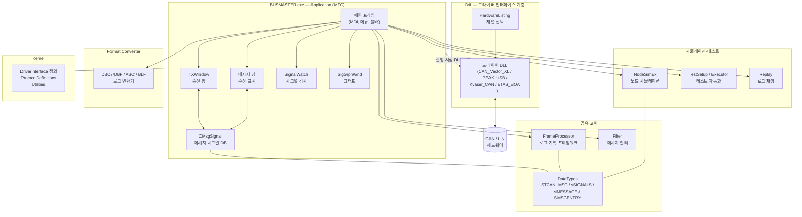

# BUSMASTER 아키텍처 분석

> 원본: [rbei-etas/busmaster](https://github.com/rbei-etas/busmaster)
> 분석 기준: `Sources/` 디렉토리 실측 (2026-10-31)
> 작성 목적: Python/PySide6 포팅을 위한 구조·클래스·메소드 분석

## 1. 개요

BUSMASTER는 CAN/LIN 버스 분석용 Windows 데스크톱 애플리케이션이다.
C++(MFC)로 작성됐으며, 하드웨어 드라이버를 DLL 형태로 실행 시점에 로드하는
플러그인 구조(DIL: Driver Interface Layer)를 갖는다.

| 항목 | 수치 |
|------|------|
| 전체 코드량 (`Sources/` 기준) | 약 50.8만 줄 |
| C++ 파일 수 (`.cpp` + `.h`) | 1,630개 |
| `Sources/BUSMASTER` | 1,544파일 / 약 49.0만 줄 |
| `Sources/Kernel` | 86파일 / 약 1.8만 줄 |
| 언어/프레임워크 | C++ / MFC (Windows 전용) |
| 빌드 | MSVC (`vcxproj`), 일부 CMake |
| 라이선스 | LGPL v3 |

## 2. 전체 코드 구성

```
Sources/
├── BUSMASTER/                  # 메인 애플리케이션 + 플러그인 모듈 (약 49.0만 줄)
│   ├── Application/            # MFC 실행 파일 본체 (225파일, 8.4만 줄)
│   ├── DataTypes/              # 공유 데이터 구조체 (34파일, 0.8만 줄)
│   ├── Include/                # 공용 헤더 (Struct_CAN_.h 등)
│   ├── DIL_Interface/          # 드라이버 선택/채널 설정 UI (11파일)
│   ├── CAN_*/LIN_*             # 하드웨어 드라이버 DLL들 (벤더별)
│   │   ├── CAN_Vector_XL, CAN_PEAK_USB, CAN_Kvaser_CAN, CAN_ETAS_BOA (6.9만 줄로 최대),
│   │   │   CAN_ICS_neoVI, CAN_IXXAT_VCI, CAN_MHS, CAN_NSI, CAN_VSCOM, CAN_iVIEW,
│   │   │   CAN_STUB, CAN_ISOLAR_EVE_VCAN
│   │   └── LIN_Vector_XL, LIN_PEAK_USB, LIN_Kvaser, LIN_ETAS_BOA, LIN_ISOLAR_EVE_VLIN
│   ├── FrameProcessor/         # 로깅 프레임워크 (43파일, 0.9만 줄)
│   ├── Filter/                 # 필터 DLL + 설정 다이얼로그 (11파일, 0.6만 줄)
│   ├── Format Converter/       # DBC↔DBF, ASC/BLF 로그 변환 등 (137파일, 2.1만 줄)
│   ├── NodeSimEx/              # 노드 시뮬레이션 (C++ 코드 생성) (88파일, 3.3만 줄)
│   ├── TXWindow/               # 송신 창 (36파일, 1.0만 줄)
│   ├── SignalWatch/            # 시그널 감시 창 (24파일, 0.3만 줄)
│   ├── SigGrphWnd/             # 시그널 그래프 창 (32파일, 0.9만 줄)
│   ├── Replay/                 # 로그 리플레이 (20파일, 0.6만 줄)
│   ├── TestSetupEditorGUI/Lib  # 테스트 셋업 에디터 (46파일, 1.6만 줄)
│   ├── TestSuiteExecutorGUI/   # 테스트 실행기 (21파일, 0.6만 줄)
│   ├── UDS_Protocol/           # UDS 진단 프로토콜 (19파일, 0.4만 줄)
│   ├── LDFEditor/              # LIN 설정(LDF) 에디터 (54파일, 1.4만 줄)
│   ├── BusEmulation/           # 버스 에뮬레이션
│   ├── CommonClass/            # 공용 클래스 (14파일)
│   ├── Utility/                # 유틸리티 (71파일, 1.5만 줄)
│   └── ProjectConfiguration/   # 프로젝트 설정
└── Kernel/                     # 커널 라이브러리 (약 1.8만 줄)
    ├── BusmasterKernel/
    ├── BusmasterDriverInterface/  # 드라이버 인터페이스 정의 (52파일, 1.2만 줄)
    ├── BusmasterDBNetwork/        # DB 네트워크
    ├── ProtocolDefinitions/
    └── Utilities/
```

### 2.1 모듈별 규모 (실측)

| 모듈 | 파일 수 | 코드 줄 수 | 역할 |
|------|--------|-----------|------|
| Application | 225 | 83,954 | MFC GUI 본체 (메인 프레임, 메뉴, 도킹) |
| CAN_ETAS_BOA | 189 | 69,035 | ETAS BOA CAN 드라이버 (최대 단일 드라이버) |
| Format Converter | 137 | 20,879 | DBC/DBF/ASC/BLF/Excel 변환기 |
| Utility | 71 | 15,024 | 공용 유틸리티 |
| LDFEditor | 54 | 14,072 | LIN LDF 에디터 |
| NodeSimEx | 88 | 33,381 | 노드 시뮬레이션 (코드 생성+실행) |
| FrameProcessor | 43 | 8,877 | 로그 기록 프레임워크 |
| TXWindow | 36 | 9,826 | 메시지 송신 창 |
| SigGrphWnd | 32 | 8,551 | 시그널 그래프 |
| SignalWatch | 24 | 3,280 | 시그널 값 감시 |
| TestSetupEditorGUI/Lib | 46 | 15,536 | 테스트 자동화 에디터 |
| TestSuiteExecutorGUI | 21 | 5,637 | 테스트 실행기 |
| UDS_Protocol | 19 | 4,096 | UDS 진단 |
| Replay | 20 | 6,402 | 로그 리플레이 |
| Filter | 11 | 6,175 | 메시지 필터 |
| DataTypes | 34 | 7,550 | 공유 구조체/타입 |
| DIL_Interface | 11 | 3,707 | 드라이버/채널 선택 UI |
| CAN_Vector_XL | 14 | 12,374 | Vector 하드웨어 드라이버 |
| CAN_Kvaser_CAN | 19 | 11,314 | Kvaser 드라이버 |
| LIN_ETAS_BOA | 76 | 36,685 | ETAS BOA LIN 드라이버 |
| Kernel/* | 86 | 18,248 | 커널, 드라이버 IF 정의, 유틸리티 |

## 3. 프로그램 구조도



### 3.1 계층 설명

| 계층 | 내용 | 포팅 여부 |
|------|------|-----------|
| **Application (MFC)** | EXE 본체. MDI 메인 프레임, 메뉴/툴바, 각 기능 창(Tx, 메시지 창, SignalWatch, 그래프)을 띄운다. Windows MFC에 강결합. | GUI는 PySide6로 재설계 (코드 번역 아님) |
| **DIL** | 실행 시점에 벤더 드라이버 DLL을 로드하는 계층. `HardwareListing`에서 채널을 선택하면 해당 DLL을 붙인다. | 인터페이스 개념만 참고, DLL 자체는 제외 |
| **드라이버 DLL** (`CAN_*`/`LIN_*`) | Vector, PEAK, Kvaser, ETAS 등 벤더 SDK 기반. 바이너리 의존. | 이식 제외 |
| **DataTypes** | 전 계층이 공유하는 구조체 (`STCAN_MSG`, `sSIGNALS`, `sMESSAGE` …). | **포팅 1순위** |
| **FrameProcessor** | 로그 기록용 프레임워크 (`CBaseLogObject` 기반). | 포팅 대상 |
| **Filter** | 수신 필터 DLL + 설정 다이얼로그. | 포팅 대상 (Phase 5+) |
| **Format Converter** | DBC↔DBF, ASC/BLF, Excel 변환. UI 의존 낮음. | **포팅 2순위** |
| **NodeSimEx** | C/C++ 코드 생성 → 컴파일 → DLL 로드 방식의 노드 시뮬레이션. | 장기 과제 (아키텍처 재설계 필요) |
| **Kernel** | 드라이버 인터페이스 정의, 프로토콜 정의, 유틸리티. | 정의·유틸만 선별 포팅 |

## 4. 핵심 클래스·메소드 분석

### 4.1 프레임 구조체 — `STCAN_MSG` (`Include/Struct_CAN_.h`)

CAN(FD) 네트워크와 주고받는 최소 단위. Python `CanFrame`으로 포팅됨.

| 필드 | 타입 | 의미 |
|------|------|------|
| `m_unMsgID` | `unsigned int` | 11/29비트 메시지 ID |
| `m_ucEXTENDED` | `unsigned char` | 29비트 확장 프레임 여부 |
| `m_ucRTR` | `unsigned char` | Remote 요청 프레임 여부 |
| `m_ucDataLen` | `unsigned char` | 데이터 길이 (0~8, FD는 ~64) |
| `m_ucChannel` | `unsigned char` | 채널 번호 |
| `m_ucData[64]` | `unsigned char[64]` | 데이터 바이트 |
| `m_bCANFD` | `bool` | CAN FD 프레임 여부 |

### 4.2 메시지·시그널 DB — `sSIGNALS` / `sMESSAGE` / `SMSGENTRY` (`DataTypes/MsgSignal_Datatypes.h`)

DBC에서 읽어온 메시지 DB의 메모리 표현. Python `DbSignal`/`DbMessage`/`MessageDatabase`로 포팅 중.

**`sSIGNALS`** — 시그널 정의 (연결 리스트):
- `m_omStrSignalName` — 시그널 이름
- `m_unStartByte` / `m_byStartBit` — 시작 바이트/비트 (0 인덱스)
- `m_unSignalLength` — 비트 길이
- `m_bySignalType` — 부호/무부호 구분
- `m_SignalMinValue` / `m_SignalMaxValue` — 물리값 범위
- `m_fSignalFactor` / `m_fSignalOffset` — 물리값 변환식 (`물리값 = raw × factor + offset`)
- `m_omStrSignalUnit` — 단위
- `m_eFormat` — 엔디안 (`eIntel` / `eMotorola`)
- `m_oSignalIDVal` — 값→설명 매핑 리스트
- `m_psNextSignalList` — 다음 시그널

**`sMESSAGE`** — 메시지 정의:
- `m_omStrMessageName`, `m_unMessageCode` (ID), `m_byMessageChannel`
- `m_unNumberOfSignals`, `m_unMessageLength`, `m_bMessageFrameFormat`
- `m_psSignals` — 시그널 연결 리스트 head
- `m_bySignalMatrix[1785]` — 시그널 비트 겹침 검증용 매트릭스
- `m_nMsgDataFormat` — 1=Intel, 0=Motorola

**`SMSGENTRY`** — 메시지 연결 리스트 노드. 정적 메소드로 리스트 관리:
- `vClearMsgList()` / `vClearSignalList()` — 메모리 해제
- `bUpdateMsgList()` — 메시지 추가/갱신
- `bGetMsgPtrFromMsgId()` — ID로 메시지 검색
- `psCopyMsgVal()` / `psCopySignalVal()` — 깊은 복사

**시그널 인코딩 핵심 로직** — `sSIGNALS::vSetSignalValue()`:
1. 값을 시그널 비트 길이로 마스킹 (`value & ((1<<len)-1)`)
2. Intel이면 `(startByte-1)*8 + startBit` 만큼 좌시프트, Motorola면 별도 비트 재배열
3. `un64GetBitMask()`로 기존 데이터에서 해당 비트를 지우고 OR로 합성

→ Python 포팅 시 `encode_signal()` / `decode_signal()` 함수로 구현한다.

### 4.3 DB 관리자 — `CMsgSignal` (`Application/MsgSignal.h`)

메시지 DB 전체를 들고 있는 관리자 클래스. 주요 메소드:

| 메소드 | 역할 |
|--------|------|
| `psGetMessagePointer(name / id)` | 이름/ID로 메시지 검색 (active/inactive DB 구분) |
| `bUpdateMsgList()` | DB에 메시지 추가·갱신 |
| `vGetSignalValidRange()` | 시그널 유효 범위 조회 |
| `bIsSignalValueOutofRange()` | 값 범위 검증 |
| `bIsDuplicateSignalValue()` | 중복 값 검사 |
| `vUpdateSignalMatrix()` | 시그널 비트 겹침 검증 |
| `vConvertExtendedToStandardFrameFormat()` | 29비트→11비트 변환 |
| `bGetDBAcitveFlagStatus()` / `vSetDBActiveFlagStatus()` | DB 활성 상태 |

내부 자료구조: `CMap<UINT, UINT, sMESSAGE*, sMESSAGE*> m_omMsgDetailsIDMap`
(ID → 메시지 포인터 해시맵) — Python에서는 `dict[int, DbMessage]`에 대응.

### 4.4 해석 결과 구조체

| 구조체 | 용도 | Python 대응 |
|--------|------|-------------|
| `sINTERPRETSIGNALINFO` | 시그널 해석 결과 (이름, raw값, 물리값, 설명, 단위) | `InterpretedSignal` |
| `SSignalInfo` (`tagSSIGNALINFO`) | 시그널 정보 문자열 묶음 | `SignalInfo` |
| `SIG_VALUE` (union) | int64/uint64 공용체 | Python `int` (任意精度) |
| `sWaveformInfo` / `SSigGeneration` | Tx 파형 생성 설정 | Phase 5+ |

### 4.5 DIL 드라이버 인터페이스 패턴

- 각 `CAN_*` / `LIN_*` 디렉토리가 독립 DLL로 빌드된다.
- 앱은 `HardwareListing` UI에서 선택된 채널에 맞는 DLL을 **실행 시점에 로드**한다.
- 모든 드라이버 DLL이 동일한 인터페이스 규약을 따른다 (DIL).
- `CAN_STUB`은 하드웨어 없이 동작하는 스텁 드라이버 — **Python 포팅의 시뮬레이션 모드**가 이 역할을 대신한다.

### 4.6 로깅 — FrameProcessor

- `CBaseLogObject` 기반 로그 객체, `CBaseFrameProcessor_CAN/LIN/J1939` 가 버스별 처리.
- 로그 설정 다이얼로그(`ConfigMsgLog*Dlg`)는 GUI이므로 Phase 4 이후.
- 로그 **포맷 자체**(ASC/BLF)는 Format Converter와 함께 Phase 3에서 포팅.

## 5. 데이터 흐름

### 5.1 수신 (Rx) 경로

```
CAN/LIN 하드웨어
  → 드라이버 DLL (DIL)
    → Application 메시지 수신 스레드 (MsgWndThread)
      → 메시지 창 표시 + SignalWatch 해석 (CMsgSignal DB 참조)
      → FrameProcessor 로그 기록
```

### 5.2 송신 (Tx) 경로

```
TXWindow (사용자 입력)
  → CMsgSignal 에서 메시지/시그널 정의 조회
  → sSIGNALS::vSetSignalValue() 로 데이터 바이트 인코딩
  → DIL → 드라이버 DLL → 하드웨어
```

### 5.3 시뮬레이션 경로 (NodeSimEx)

```
사용자 C++ 코드 → NodeSimEx 코드 생성/컴파일 → DLL 로드
  → 가상 노드가 송수신에 참여
※ Python 포팅에서는 Python 스크립트 기반 가상 노드로 재설계 예정 (장기)
```

## 6. 포팅 매핑 상세 (원본 → Python)

| # | 원본 모듈 (C++) | 규모 | Python 모듈 | 우선순위 | 상태 |
|---|----------------|------|-------------|----------|------|
| 1 | `Include/Struct_CAN_.h` | — | `bsmaster/core/datatypes.py` (`CanFrame`, `CanError`) | 최우선 | ✅ 완료 |
| 2 | `DataTypes/MsgSignal_Datatypes.h` (`sSIGNALS`, `sMESSAGE`, `SMSGENTRY`) | 240줄 | `bsmaster/core/msgsignal.py` (`DbSignal`, `DbMessage`, `MessageDatabase`) | 최우선 | ✅ 완료 |
| 3 | `sSIGNALS::vSetSignalValue`, `un64GetBitMask` | — | `bsmaster/core/msgsignal.py` (`encode_signal`, `decode_signal`) | 최우선 | ✅ 완료 |
| 4 | `Application/MsgSignal.h` (`CMsgSignal`) | — | `bsmaster/core/database.py` | 높음 | 예정 |
| 5 | `Format Converter/DBC2DBFConverter` (`dbc_dbf_Lexer.l`) | — | `bsmaster/dbc/parser.py` (`DbcDatabase`, Motorola 시작비트 변환 포함) | 높음 | ✅ 완료 |
| 6 | `Format Converter/AscLogConverter`, `BlfLogConverter`, `BlfLibrary` | — | `bsmaster/logconv/` (`frames`/`asc`/`blf`, zlib 컨테이너·CAN_MESSAGE 처리) | 높음 | ✅ 완료 |
| 7 | `Application/` (MFC 메인 프레임) | 225파일 | `bsmaster/gui/` (메인 윈도우 + 메시지/시그널/전송 도크, 시뮬레이션) | 높음 | ✅ 완료 |
| 8 | `DataTypes/Filter_Datatypes.h`, `Filter/` | 6천 줄 | `bsmaster/core/filters.py` (단일 ID/범위 필터 + Pass/Stop, GUI 연동) | 중간 | ✅ 완료 |
| 9 | `DataTypes/Log_Datatypes.h`, `FrameProcessor/` | 8.9천 줄 | `bsmaster/core/logging.py` (트리거·필터·ASC/BLF 기록) | 중간 | ✅ 완료 |
| 10 | `TXWindow/`, `SignalWatch/`, `SigGrphWnd/` | 2.2만 줄 | `bsmaster/gui/` 하위 위젯 | 중간 | 예정 |
| 11 | `DataTypes/J1939_DataTypes.h`, `UDS_Protocol/` | 4천 줄+ | `bsmaster/j1939/` (29비트 ID 분해·PGN·메시지 타입), `bsmaster/uds/` (서비스·NRC·ISO-TP) | 낮음 | J1939·UDS 기본 완료 |
| 12 | `NodeSimEx/` | 3.3만 줄 | `bsmaster/nodesim/` (VirtualNode + VirtualBus, DBC 시그널 송신) | 낮음 | ✅ 기본 완료 |
| 13 | `CAN_*` / `LIN_*` 드라이버 DLL | 20만 줄+ | **이식 제외** | — | 제외 |
| 14 | `DIL_Interface/` 하드웨어 선택 UI | — | 시뮬레이션 모드로 대체 | — | 제외 |

## 7. 리스크 및 설계 판단

1. **MFC → Qt는 번역이 아니라 재설계다.** 화면 단위로 새로 만든다. 기존 `.rc` 다이얼로그 리소스는 참고용으로만 쓴다.
2. **드라이버 DLL은 건드리지 않는다.** 20만 줄이 넘는 벤더 드라이버는 Python에서 재현할 수 없고, 할 필요도 없다. `CAN_STUB` 개념을 이어받아 "시뮬레이션 모드"를 기본 동작으로 한다.
3. **DBC 파싱이 포팅의 첫 번째 실질 관문이다.** `dbc_dbf_Lexer.l` (lex/yacc 기반)을 Python 파서로 다시 쓴다. DBC는 텍스트 포맷이라 파싱 자체는 straightforward하다.
4. **NodeSimEx는 장기 과제다.** C++ 컴파일→DLL 로드 구조를 Python에서는 가상 노드 스크립트 방식으로 재설계해야 한다. 당장 손대지 않는다.
5. **인코딩 로직(`vSetSignalValue`)을 먼저 포팅한다.** 시그널 비트 배치 규칙(Intel/Motorola)은 DBC 파서와 Tx 경로 양쪽에서 쓰이는 핵심이라, Phase 1에서 함수 단위로 검증한다.

---
*상세 단계별 일정은 [PORTING_PLAN.md](PORTING_PLAN.md)를 참고.*
